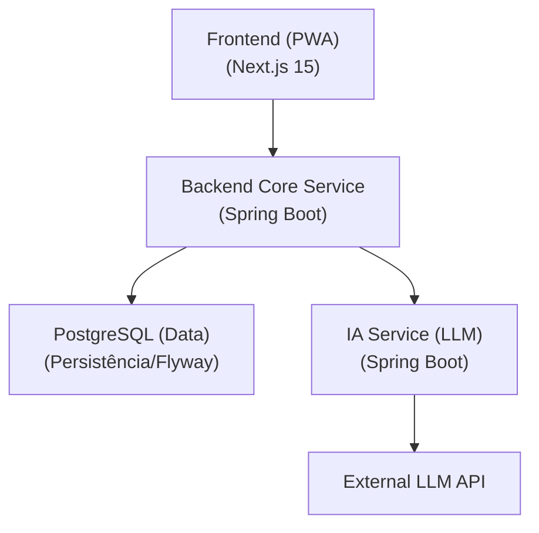

# 🗺️ KYU — Plataforma de Roteirização Turística


MVP de roteirização turística inteligente. O sistema calcula e gera roteiros categorizados combinando dados reais de geolocalização com curadoria e validação via Inteligência Artificial (LLM).

---

## 🏗️ Arquitetura do Sistema

O projeto é estruturado em uma arquitetura de microsserviços monorepo, separando responsabilidades de orquestração, inteligência e interface do usuário:



- **Frontend**: PWA construído com Next.js (App Router) otimizado para navegação mobile-first.
- **Backend Core**: Serviço em Spring Boot (Java 25) responsável por orquestração, regras de negócio e contratos de API.
- **IA Service**: Microsserviço focado em curadoria, validação de dados turísticos e comunicação com o provedor de LLM.
- **Database**: Banco relacional PostgreSQL 15 com migrações automatizadas via Flyway.

## 📁 Estrutura do Repositório

```text
.
├── backend-core/          # Serviço principal Spring Boot (API, JPA, Security, Flyway)
├── ia-service/             # Serviço Spring Boot para integração com LLM
├── frontend/               # Aplicação Next.js (PWA)
├── docs/                   # Arquitetura, ADRs, OpenAPI, guia de setup
├── .github/                # Workflows de Integração Contínua (CI)
├── docker-compose.yml      # Orquestração de infraestrutura (ambiente de desenvolvimento)
├── docker-compose.prod.yml # Orquestração de infraestrutura (ambiente de produção)
└── .env                    # Variáveis de ambiente (não versionado)
```

## 🚀 Como Executar o Projeto

### Pré-requisitos
- Docker e Docker Compose instalados.
- Node.js 20+ (para desenvolvimento local do frontend).
- JDK 25 e Maven 3.9+ (para desenvolvimento local dos serviços Java).

### 1. Configuração de Variáveis de Ambiente
Crie um arquivo `.env` na raiz do repositório baseado no modelo `.env.example`:

```bash
cp .env.example .env
```

Edite o arquivo `.env` inserindo suas chaves de API locais (como a chave do provedor de LLM e do Google Maps).

### 2. Executando o Ambiente Completo com Docker Compose
Para subir toda a infraestrutura (Banco de Dados, Backend e Frontend) a partir da raiz do repositório:

```bash
docker compose up -d
```

O ambiente estará acessível nos seguintes endereços:

- **Frontend**: `http://localhost:3000`
- **Backend Core API**: `http://localhost:8080`
- **PostgreSQL**: `localhost:5432`

### 3. Execução Individual para Desenvolvimento
Caso prefira rodar os serviços individualmente para desenvolvimento nativo:

#### Frontend:

```bash
cd frontend
npm install
npm run dev
```

#### Backend Core:

```bash
cd backend-core
./mvnw spring-boot:run
```

### ⚙️ Variáveis de Ambiente Principais

| Variável | Descrição | Exemplo Padrão |
|----------|-----------|----------------|
| `DB_USER` | Usuário do PostgreSQL | `postgres` |
| `DB_PASSWORD` | Senha do banco de dados | `local_password_123` |
| `DB_NAME` | Nome do banco de dados | `pwa_db` |
| `NEXT_PUBLIC_API_URL` | URL do Backend acessada pelo navegador (Client-side) | `http://localhost:8080` |
| `INTERNAL_API_URL` | URL do Backend acessada pelo servidor Next.js em contêiner | `http://backend-core:8080` |
| `LLM_API_KEY` | Chave de autenticação do provedor de Inteligência Artificial | `sk-...` |
| `GOOGLE_MAPS_API_KEY` | Chave de acesso às APIs do Google Maps | `AIzaSy...` |

