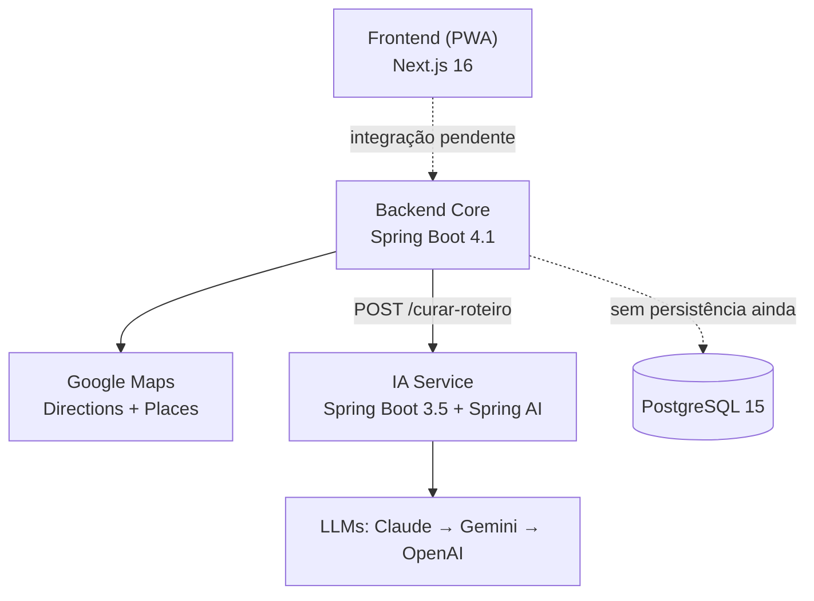

# 🗺️ KYU — Plataforma de Roteirização Turística


MVP de roteirização turística inteligente. O sistema calcula e gera roteiros categorizados combinando dados reais de geolocalização (Google Maps) com curadoria e classificação de pontos de interesse via Inteligência Artificial (LLM).

O cenário usado nos dados e nos prompts é: **Aeroporto Internacional de Foz do Iguaçu → pontos de interesse no trajeto → Grand Carimã Resort & Convention Center** (local do evento).

---

## 🏗️ Arquitetura do Sistema

O projeto é um monorepo com três aplicações, separando orquestração, inteligência e interface:



Linhas tracejadas indicam ligações previstas que ainda não estão implementadas (veja [Estado atual](#-estado-atual-do-mvp)).

- **Frontend**: PWA em Next.js (App Router), Tailwind CSS v4 e Google Maps, pensado para uso mobile-first.
- **Backend Core**: Spring Boot (Java 25). Responsável por orquestração, regras de negócio e contratos de API. Consulta Google Directions e Places e envia os POIs ao IA Service para curadoria.
- **IA Service**: Spring Boot (Java 21) + Spring AI. Faz a curadoria dos POIs (classifica em `trilha` e `tipo` e gera a descrição) com uma cadeia de fallback entre provedores de LLM: Claude → Gemini → OpenAI → resposta sem curadoria. Cada provedor entra na cadeia somente se sua chave de API estiver configurada.
- **Database**: PostgreSQL 15, com Flyway previsto para migrações.

## 📁 Estrutura do Repositório

```text
.
├── backend-core/              # API principal (Spring Boot, pacote br.tourapp.kyr)
├── ia-service/                # Curadoria com LLMs (Spring Boot, pacote br.tourapp.iaservice)
├── frontend/                  # PWA em Next.js
├── docs/                      # OpenAPI, relatório de curadoria, dataset de POIs e documentação técnica
├── .github/workflows/         # CI de cada aplicação
├── docker-compose.yaml        # Ambiente de desenvolvimento
├── docker-compose.prod.yaml   # Ambiente de produção
├── .env.example               # Modelo de variáveis de ambiente
└── CONTEXT.md                 # Contexto técnico detalhado do repositório
```

Conteúdo de `docs/`:

| Arquivo | Descrição |
|---|---|
| `openapi.yml` | Contrato OpenAPI da API de roteirização |
| `Relatorio curadoria de POI.md` | Critérios e decisões da curadoria dos POIs |
| `dataset-pois-foz.json` | Dataset curado de referência (18 POIs) |
| `decodificacao-polyline-google.md` | Explicação do algoritmo de polyline do Google |
| `assets/` | Imagens dos trajetos aeroporto → POI → hotel |

### Convenção de pacotes Java

| Módulo | Pacote raiz |
|---|---|
| `backend-core` | `br.tourapp.kyr` |
| `ia-service` | `br.tourapp.iaservice` |

No `backend-core`, todas as classes (inclusive `poi.*`, `config.*`, `controller`, `dto` e `service`) ficam sob `br.tourapp.kyr`, o mesmo pacote da `KyrApplication`. Classes fora desse pacote **não** são encontradas pelo component scan do Spring.

## 🚀 Como Executar o Projeto

### Pré-requisitos
- Docker e Docker Compose.
- Node.js 20+ (desenvolvimento local do frontend).
- JDK 25 (`backend-core`) e JDK 21 (`ia-service`). O Maven Wrapper (`mvnw`) já está incluído em cada módulo.

### 1. Variáveis de ambiente
Crie o arquivo `.env` na raiz a partir do modelo:

```bash
cp .env.example .env
```

Preencha ao menos `GOOGLE_MAPS_API_KEY`. Para a curadoria por IA, informe pelo menos uma das chaves de LLM (`ANTHROPIC_API_KEY`, `GEMINI_API_KEY` ou `OPENAI_API_KEY`). Sem nenhuma, o `ia-service` sobe normalmente e devolve os POIs sem curadoria. O arquivo `.env` precisa conter apenas linhas no formato `VARIAVEL=valor` (ou comentários iniciados por `#`).

Para exibir o mapa real no frontend, crie também `frontend/.env.local`:

```text
NEXT_PUBLIC_GOOGLE_MAPS_API_KEY=<sua-chave-publica>
```

Sem essa chave, `/criar-roteiro` usa uma ilustração estática no lugar do mapa.

> Nunca versione `.env` nem `frontend/.env.local`.

### 2. Ambiente completo com Docker Compose
Na raiz do repositório:

```bash
docker compose up -d
```

| Serviço | URL |
|---|---|
| Frontend | `http://localhost:3000` |
| Backend Core | `http://localhost:8080` |
| IA Service | `http://localhost:8000` |
| PostgreSQL | `localhost:5432` |

Produção local:

```bash
docker compose -f docker-compose.prod.yaml up -d --build
```

### 3. Execução individual (desenvolvimento nativo)

**Frontend**

```bash
cd frontend
npm install
npm run dev
```

**Backend Core** (requer um PostgreSQL acessível e `SPRING_DATASOURCE_*` configuradas)

```bash
cd backend-core
./mvnw spring-boot:run
```

**IA Service**

```bash
cd ia-service
./mvnw spring-boot:run
```

No Windows, use `.\mvnw.cmd` no lugar de `./mvnw`.

## 🔌 Endpoints

### Backend Core (`:8080`)

| Método | Rota | Descrição |
|---|---|---|
| `POST` | `/roteiros` | Recebe origem e destino quaisquer (`nome`, `latitude`, `longitude`), busca POIs no Google Places ao longo da rota, envia os mais bem avaliados (até 10 por padrão) à curadoria do `ia-service` e ordena o resultado via Google Directions. Detalhes abaixo. |
| `GET` | `/api/v1/rotas/pois` | Busca POIs reais (Google Places) ao longo da rota aeroporto → evento. Aceita `raioMetros` opcional. Erros do Google retornam `502`. |

### IA Service (`:8000`)

| Método | Rota | Descrição |
|---|---|---|
| `POST` | `/curar-roteiro` | Recebe uma lista de POIs brutos (`nome`, `categoria`, `coordenadas`) e devolve cada um classificado em `trilha` (`turismo` \| `compras`) e `tipo` (`alimentacao` \| `lazer`), com descrição em português. A resposta usa `snake_case` (`curado_por_ia`, `modelo_utilizado`). |
| `GET` | `/actuator/health` | Health-check. |

### Resposta do `POST /roteiros`

O contrato completo está em [`docs/openapi.yml`](./docs/openapi.yml).

- `pontos[]`: `nome`, `trilha`, `tipo`, `endereco`, `latitude`, `longitude`, `fonte` (link do lugar no Google Maps), `descricao`, `curado`, `distanciaMetros` e `duracaoSegundos`.
- `metadados`: `totalPontos`, `tempoRespostaMs`, `fonteIA` (modelo que curou, ou `sem-curadoria`), `curadoPorIa` e `fonteRota` (`google-directions-api` ou `fallback-sem-otimizacao`).

| Situação | Resposta |
|---|---|
| Tudo funcionou | `200`, POIs curados e ordenados, com distância e duração por trecho |
| `ia-service` fora do ar, com erro ou lento demais | `200` sem curadoria: `curado = false`, `trilha`/`tipo`/`descricao` nulos, `curadoPorIa = false`, `fonteIA = "sem-curadoria"` |
| Directions API falhou | `200` na ordem da seleção, sem distância nem duração, `fonteRota = "fallback-sem-otimizacao"` |
| Nenhum POI encontrado na rota | `200` com `pontos` vazio |
| Corpo inválido | `400` |
| Google Places ou busca da rota falharam (inclusive sem `GOOGLE_MAPS_API_KEY`) | `502` com `{ "codigo": "erro_integracao_google_maps", "mensagem": "..." }` |

O roteiro gerado não é gravado no banco.

## ⚙️ Variáveis de Ambiente

| Variável | Usada por | Descrição | Padrão |
|----------|-----------|-----------|--------|
| `DB_USER` | PostgreSQL | Usuário do banco | `postgres` |
| `DB_PASSWORD` | PostgreSQL | Senha do banco | `local_password_123` |
| `DB_NAME` | PostgreSQL | Nome do banco | `pwa_db` |
| `GOOGLE_MAPS_API_KEY` | backend-core | Chave das APIs Directions e Places | — |
| `IA_SERVICE_URL` | backend-core | Endereço do `ia-service` (no Docker Compose já vem como `http://ia-service:8000`) | `http://localhost:8000` |
| `IA_SERVICE_TIMEOUT_SECONDS` | backend-core | Tempo máximo (s) de espera pela curadoria antes de devolver o roteiro sem ela | `40` |
| `ROTEIRO_MAX_POIS_CURADORIA` | backend-core | Quantidade máxima de POIs (os de maior nota) enviados à curadoria | `10` |
| `NEXT_PUBLIC_GOOGLE_MAPS_API_KEY` | frontend | Chave pública do Maps JavaScript API (em `frontend/.env.local`) | — |
| `NEXT_PUBLIC_API_URL` | frontend | URL do backend acessada pelo navegador | `http://localhost:8080` |
| `INTERNAL_API_URL` | frontend | URL do backend acessada pelo servidor Next.js dentro do Docker | `http://backend-core:8080` |
| `ANTHROPIC_API_KEY` | ia-service | Habilita o provedor Claude | — |
| `ANTHROPIC_MODEL` | ia-service | Modelo do Claude | `claude-haiku-4-5-20251001` |
| `GEMINI_API_KEY` | ia-service | Habilita o provedor Gemini | — |
| `GEMINI_MODEL` | ia-service | Modelo do Gemini | `gemini-2.5-flash` |
| `OPENAI_API_KEY` | ia-service | Habilita o provedor OpenAI | — |
| `OPENAI_MODEL` | ia-service | Modelo da OpenAI | `gpt-4o-mini` |
| `LLM_TIMEOUT_SECONDS` | ia-service | Timeout (s) aplicado a cada provedor da cadeia | `8` |

## 🧪 Testes e Integração Contínua

```bash
# backend-core
cd backend-core && ./mvnw clean verify

# ia-service
cd ia-service && ./mvnw clean verify

# frontend
cd frontend && npm run lint && npm run build
```

- `backend-core`: o teste de contexto usa Testcontainers (requer Docker em execução). `RotaPoiServiceIT` só roda se `GOOGLE_MAPS_API_KEY` estiver definida.
- `ia-service`: o teste de integração com LLM real só roda com `RUN_LLM_INTEGRATION_TESTS=1` e ao menos uma chave de LLM definida. Ele faz chamadas reais e pode gerar custo.
- O frontend ainda não tem testes automatizados; o CI roda lint e build.

Os workflows em `.github/workflows/` rodam em PRs para `main`: `ci-backend-core.yml` (Java 25), `ci-ia-service.yml` (Java 21) e `ci-frontend.yml` (Node 24).

## 📌 Estado atual do MVP

- **Pronto**: curadoria com cadeia de fallback de LLMs no `ia-service`; `POST /roteiros` do `backend-core` integrado de ponta a ponta no backend (Places na rota informada → curadoria no `ia-service` → ordenação na Directions); formulário de criação de roteiro, mapa e lista de POIs no frontend.
- **Pendente**: o frontend ainda não chama o backend (usa dados mockados), e o PostgreSQL ainda não é usado pela aplicação (sem entidades nem migrações Flyway).

Para o detalhamento técnico (contratos, divergências, dívidas conhecidas e convenções), consulte o [`CONTEXT.md`](./CONTEXT.md).

## 🌐 Ambiente em Produção

| Serviço | URL |
|---|---|
| **Frontend** | https://kyr-frontend.onrender.com |
| **Backend Core (Health-check)** | https://kyr-backend-hkq1.onrender.com/actuator/health |

> ⚠️ O free tier do Render hiberna os serviços após períodos de inatividade. A primeira requisição após um tempo parado pode levar até 50s para responder.
