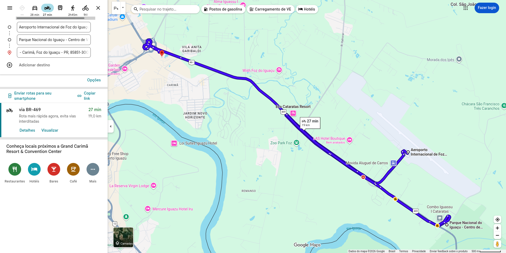
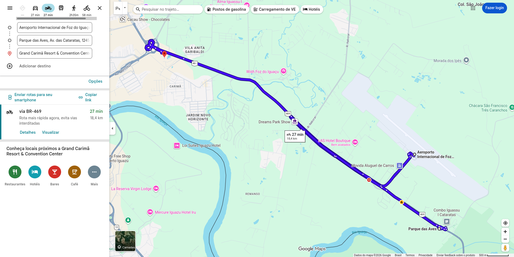
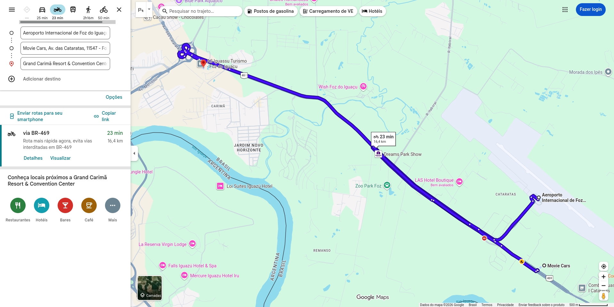

Este documento registra a curadoria manual dos Pontos de Interesse (POIs) utilizados como baseline para validação do modelo de IA. Todos os pontos estão contidos no eixo geográfico entre o Aeroporto Internacional de Foz do Iguaçu e o local do evento.

A validação visual assume o sentido principal de chegada do turista à cidade. A curadoria segue um príncipio de rota nessa ordem: 

```
Origem (Aeroporto) → Parada (POI) → Destino Final (Grand Carimã)
```

### Detalhes dos pontos de origem e destino:

Não faz sentido o ponto de origem e destino estarem no dataset, isso é tratado no backend como parâmetros fixos do contrato da API. O dataset deve conter apenas os pontos que ficam no trajeto.

#### Origem: Aeroporto de Foz do Iguaçu
Endereço: "Rod. BR 469, Kms 16,5, s/n - Aeroporto, Foz do Iguaçu - PR, 85863-900"

Fonte: "https://maps.app.goo.gl/kRDU27nKoXUx7R1x6"

#### Destino: Grand Carimã Resort & Convention Center (Local Latinware 2026)
Endereço: "Av. das Cataratas, 4790 - Carimã, Foz do Iguaçu - PR, 85851-300"

Fonte: "https://maps.app.goo.gl/8XKeoyQbX5fQxstT7"

**Relação Espacial:**
*(Abaixo, visualização do trajeto: 'Aeroporto → Grand Carimã)*

*Fonte: Adaptado de Google Maps pelos autores.*

---

## 1. Cataratas do Iguaçu (Parque Nacional do Iguaçu)
Detalhe: O local exato que usamos foi o 'Parque Nacional do Iguaçu - Centro de Visitantes - Cataratas' com o endereço do terminal de ônibus. Pois o turista precisa,obrigatoriamente, passar pelo centro de visitantes para conseguir acessar o local. Foi uma decisão importante de modelagem de dados, dado que o endereço genérico da reserva leva a um ponto distante na mata, quebrando o roteamento do sistema.

**Trilha:** Turismo | **Tipo:** Lazer
**Fonte:** [Link Google Maps](https://maps.app.goo.gl/mWfjwq78VQKvUKL16)

> **Descrição Curada:** 
Principal atração da região e Patrimônio Natural da Humanidade, abriga as famosas quedas d'água. Oferece infraestrutura completa para passeios ecológicos e contemplação da natureza em meio à Mata Atlântica.

**Relação Espacial:**
*(Abaixo, visualização do trajeto: Aeroporto → Cataratas do Iguaçu → Grand Carimã)*

*Fonte: Adaptado de Google Maps pelos autores.*

---

## 2. Parque das Aves
**Trilha:** Turismo | **Tipo:** Lazer
**Fonte:** [Link Google Maps](https://maps.app.goo.gl/DhiuABmW3ETV7Lkd9)

> **Descrição Curada:** 
Maior parque de aves da América Latina, dedicado à conservação de espécies da Mata Atlântica. Oferece uma experiência imersiva com trilhas e viveiros onde o visitante tem contato direto com araras, tucanos e outras aves.

**Relação Espacial:**
*(Abaixo, visualização do trajeto: Aeroporto → Parque das Aves → Grand Carimã)*

*Fonte: Adaptado de Google Maps pelos autores.*

## 3. Dreamland Museu de Cera"
**Trilha:** Turismo | **Tipo:** Lazer
**Fonte:** [Link Google Maps](https://maps.app.goo.gl/C7cM35Va4dk7pDNR6)

> **Descrição Curada:** 
Complexo de entretenimento que conta com dezenas de estátuas de cera de personalidades famosas. O local também abriga o Vale dos Dinossauros e o Maravilhas do Mundo, sendo ideal para fotos.

**Relação Espacial:**
*(Abaixo, visualização do trajeto: Aeroporto → Dreamland → Grand Carimã)*

*Fonte: Adaptado de Google Maps pelos autores.*

## 4. Wonder Park Foz (Movie Cars)
**Trilha:** Turismo | **Tipo:** Lazer
**Fonte:** [Link Google Maps](https://maps.app.goo.gl/NhczuxaGdcAZPhVV9)

> **Descrição Curada:** 
Parque temático que exibe dezenas de carros famosos do cinema e da cultura pop em cenários imersivos. A atração também oferece o espetáculo noturno Water Show, com águas dançantes.

**Relação Espacial:**
*(Abaixo, visualização do trajeto: Aeroporto → Wonder Park Foz → Grand Carimã)*

*Fonte: Adaptado de Google Maps pelos autores.*

---

## 5. Shopping Catuaí Palladium
**Trilha:** Compras | **Tipo:** Alimentação
**Fonte:** [Link Google Maps](https://maps.app.goo.gl/DUzSNUA18QjcqPeD7)

> **Descrição Curada:** 
Um dos maiores shoppings do Paraná, oferecendo ampla variedade de lojas nacionais e internacionais. Conta com uma praça de alimentação diversificada e opções de lazer indoor.

**Relação Espacial:**
*(Abaixo, visualização do trajeto: Aeroporto → Shopping Catuaí Palladium → Grand Carimã)*

*Fonte: Adaptado de Google Maps pelos autores.*