Este documento registra a curadoria manual dos Pontos de Interesse (POIs) utilizados como baseline para validação do modelo de IA. Todos os pontos estão contidos no eixo geográfico entre o Aeroporto Internacional de Foz do Iguaçu e o local do evento.

A validação visual assume o sentido principal de chegada do turista à cidade. A curadoria segue um príncipio de rota nessa ordem: 

```
Origem (Aeroporto) → Parada (POI) → Destino Final (Grand Carimã)
```

### Detalhes dos pontos de origem e destino:

Não faz sentido o ponto de origem e destino estarem no dataset, isso é tratado no backend como parâmetros fixos do contrato da API. O dataset deve conter apenas os pontos que ficam no trajeto.

#### Origem: Aeroporto de Foz do Iguaçu
Endereço: "Rod. BR 469, Kms 16,5, s/n - Aeroporto, Foz do Iguaçu - PR, 85863-900"

Fonte: "https://maps.app.goo.gl/kRDU27nKoXUx7R1x6"

#### Destino: Grand Carimã Resort & Convention Center (Local Latinware 2026)
Endereço: "Av. das Cataratas, 4790 - Carimã, Foz do Iguaçu - PR, 85851-300"

Fonte: "https://maps.app.goo.gl/8XKeoyQbX5fQxstT7"

**Relação Espacial:**
*(Abaixo, visualização do trajeto: 'Aeroporto → Grand Carimã)*
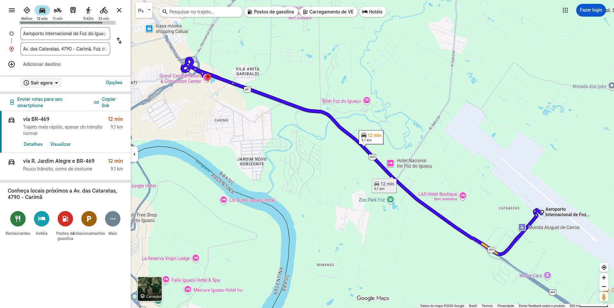
*Fonte: Adaptado de Google Maps pelos autores.*

## Distribuição de Classes do Dataset

Este dataset não é uma amostra estatisticamente representativa do universo de pontos turísticos da cidade. A distribuição atual entre as combinações trilha × tipo é:

| Combinação | Contagem | % |
|---|---|---|
| Turismo + Lazer | 7 | 38,9% |
| Turismo + Alimentação | 5 | 27,8% |
| Compras + Lazer | 3 | 16,7% |
| Compras + Alimentação | 3 | 16,7% |
| **Total** | **18** | **100%** |

Por trilha: Turismo = 12 POIs (66,7%) e Compras = 6 POIs (33,3%). O desbalanceamento reflete em parte a própria natureza da região, mas também limita a granularidade de qualquer métrica reportada por classe: com apenas 3 POIs em cada subclasse de Compras, um único item pesa 33,3 pontos percentuais no resultado.

# Detalhamento dos locais

## 1. Cataratas do Iguaçu (Parque Nacional do Iguaçu)
Detalhe: O local exato que usamos foi o 'Parque Nacional do Iguaçu - Centro de Visitantes - Cataratas' com o endereço do terminal de ônibus. Pois o turista precisa,obrigatoriamente, passar pelo centro de visitantes para conseguir acessar o local. Foi uma decisão importante de modelagem de dados, dado que o endereço genérico da reserva leva a um ponto distante na mata, quebrando o roteamento do sistema.

**Trilha:** Turismo | **Tipo:** Lazer
**Fonte:** [Link Google Maps](https://maps.app.goo.gl/mWfjwq78VQKvUKL16)

> **Descrição Curada:** 
Principal atração da região e Patrimônio Natural da Humanidade, abriga as famosas quedas d'água. Oferece infraestrutura completa para passeios ecológicos e contemplação da natureza em meio à Mata Atlântica.

**Relação Espacial:**
*(Abaixo, visualização do trajeto: Aeroporto → Cataratas do Iguaçu → Grand Carimã)*

*Fonte: Adaptado de Google Maps pelos autores.*

---

## 2. Parque das Aves
**Trilha:** Turismo | **Tipo:** Lazer
**Fonte:** [Link Google Maps](https://maps.app.goo.gl/DhiuABmW3ETV7Lkd9)

> **Descrição Curada:** 
Maior parque de aves da América Latina, dedicado à conservação de espécies da Mata Atlântica. Oferece uma experiência imersiva com trilhas e viveiros onde o visitante tem contato direto com araras, tucanos e outras aves.

**Relação Espacial:**
*(Abaixo, visualização do trajeto: Aeroporto → Parque das Aves → Grand Carimã)*

*Fonte: Adaptado de Google Maps pelos autores.*

---

## 3. Dreamland Museu de Cera
**Trilha:** Turismo | **Tipo:** Lazer
**Fonte:** [Link Google Maps](https://maps.app.goo.gl/C7cM35Va4dk7pDNR6)

> **Descrição Curada:** 
Complexo de entretenimento que conta com dezenas de estátuas de cera de personalidades famosas. O local também abriga o Vale dos Dinossauros e o Maravilhas do Mundo, sendo ideal para fotos.

**Relação Espacial:**
*(Abaixo, visualização do trajeto: Aeroporto → Dreamland → Grand Carimã)*

*Fonte: Adaptado de Google Maps pelos autores.*

---

## 4. Wonder Park Foz (Movie Cars)
**Trilha:** Turismo | **Tipo:** Lazer
**Fonte:** [Link Google Maps](https://maps.app.goo.gl/NhczuxaGdcAZPhVV9)

> **Descrição Curada:** 
Parque temático que exibe dezenas de carros famosos do cinema e da cultura pop em cenários imersivos. A atração também oferece o espetáculo noturno Water Show, com águas dançantes.

**Relação Espacial:**
*(Abaixo, visualização do trajeto: Aeroporto → Wonder Park Foz → Grand Carimã)*

*Fonte: Adaptado de Google Maps pelos autores.*

---

## 5. Shopping Catuaí Palladium
**Trilha:** Compras | **Tipo:** Lazer
**Fonte:** [Link Google Maps](https://maps.app.goo.gl/DUzSNUA18QjcqPeD7)

> **Descrição Curada:** 
Um dos maiores shoppings do Paraná, oferecendo ampla variedade de lojas nacionais e internacionais. Conta com opções de entretenimento indoor, cinema e uma diversificada praça de alimentação.

**Relação Espacial:**
*(Abaixo, visualização do trajeto: Aeroporto → Shopping Catuaí Palladium → Grand Carimã)*
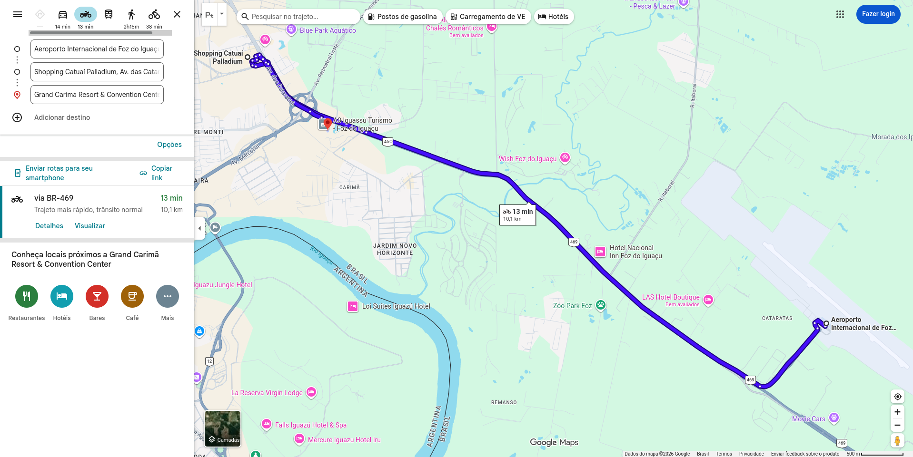
*Fonte: Adaptado de Google Maps pelos autores.*

---

## 6. Parque Aquático Cataratas
**Trilha:** Turismo | **Tipo:** Lazer
**Fonte:** [Link Google Maps](https://maps.app.goo.gl/HP2Eur6GC69X9fJN6)

> **Descrição Curada:** 
Balneário com piscinas de água corrente, toboáguas e infraestrutura de lazer para a família. O espaço também conta com um pavilhão que oferece bar e opções de gastronomia popular.

**Relação Espacial:**
*(Abaixo, visualização do trajeto: Aeroporto → Parque Aquático Cataratas → Grand Carimã)*
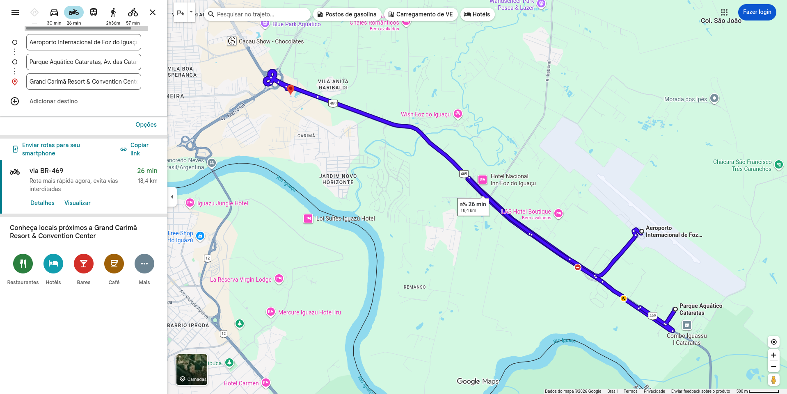
*Fonte: Adaptado de Google Maps pelos autores.*

---

## 7. Rafain Churrascaria Show
**Trilha:** Turismo | **Tipo:** Alimentação
**Fonte:** [Link Google Maps](https://maps.app.goo.gl/aPPSKwdf8o9s8rDaA)

> **Descrição Curada:** 
Tradicional churrascaria de Foz do Iguaçu que combina um vasto buffet de carnes com um espetáculo noturno celebrando a cultura latino-americana.

**Relação Espacial:**
*(Abaixo, visualização do trajeto: Aeroporto → Rafain Churrascaria Show → Grand Carimã)*
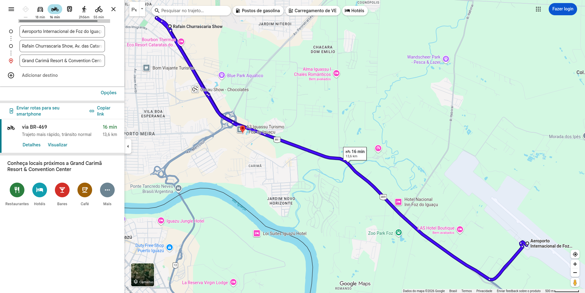
*Fonte: Adaptado de Google Maps pelos autores.*

---

## 8. Cantina da Bea
**Trilha:** Turismo | **Tipo:** Alimentação
**Fonte:** [Link Google Maps](https://maps.app.goo.gl/pJnU4HNPQeamYUUo9)

> **Descrição Curada:** 
Opção aconchegante e familiar focada em comida caseira e pratos rápidos. Ideal para uma parada gastronômica sem grandes desvios na rota.

**Relação Espacial:**
*(Abaixo, visualização do trajeto: Aeroporto → Cantina da Bea → Grand Carimã)*
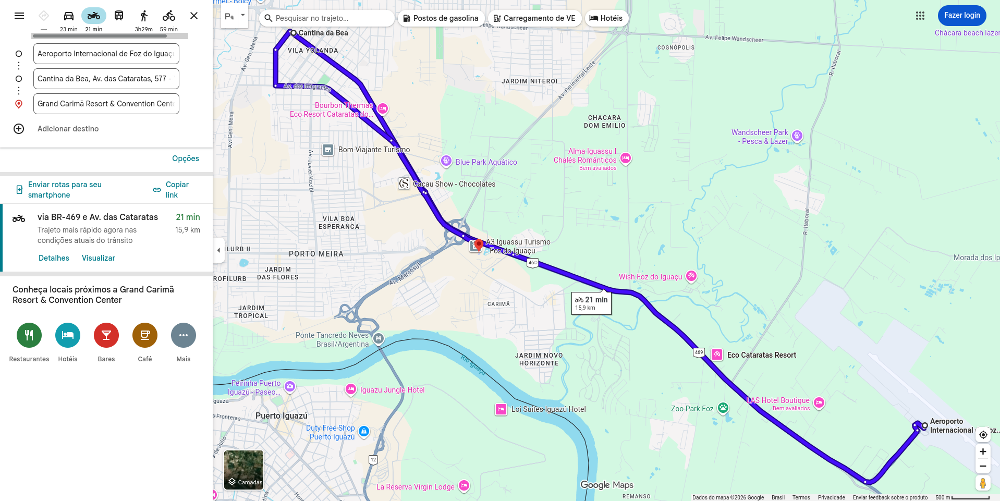
*Fonte: Adaptado de Google Maps pelos autores.*

---

## 9. V8 Garagem Bar
**Trilha:** Turismo | **Tipo:** Alimentação
**Fonte:** [Link Google Maps](https://maps.app.goo.gl/WQkuAXFL7j1ud5uu6)

> **Descrição Curada:** 
Bar temático com inspiração automotiva, oferecendo um ambiente descontraído para o happy hour. Conta com cardápio variado de lanches, porções e bebidas na rota principal.

**Relação Espacial:**
*(Abaixo, visualização do trajeto: Aeroporto → V8 Garagem Bar → Grand Carimã)*
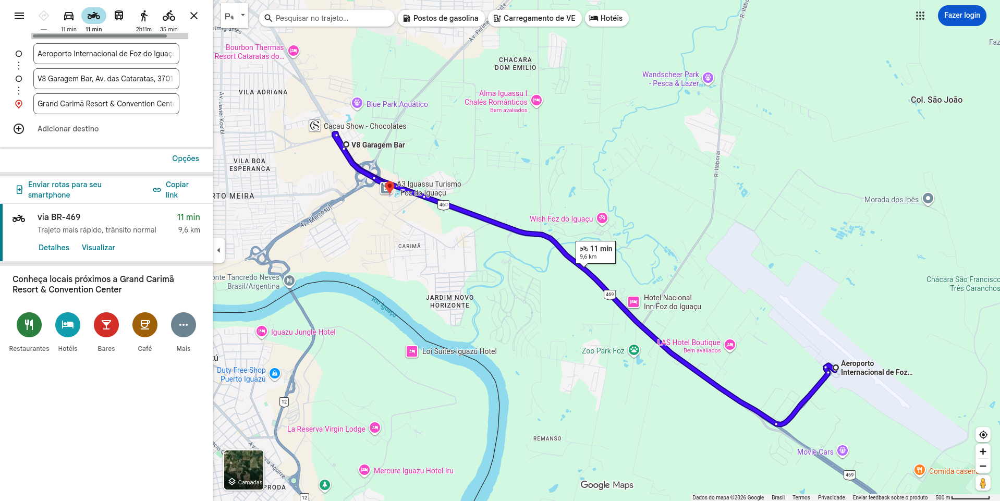
*Fonte: Adaptado de Google Maps pelos autores.*

---

## 10. Empório com Arte
**Trilha:** Compras | **Tipo:** Alimentação
**Fonte:** [Link Google Maps](https://maps.app.goo.gl/rsv3V6B2FcYBHVFS8)

> **Descrição Curada:** 
Mistura de bistrô, café e loja de artesanato. Perfeito para refeições leves e para adquirir souvenires locais em um ambiente rústico.

**Relação Espacial:**
*(Abaixo, visualização do trajeto: Aeroporto → Empório com Arte → Grand Carimã)*
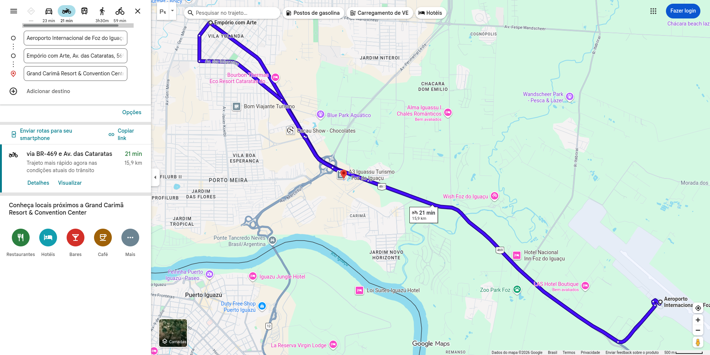
*Fonte: Adaptado de Google Maps pelos autores.*

---

## 11. Bona Trattoria Gastronomia
**Trilha:** Turismo | **Tipo:** Alimentação
**Fonte:** [Link Google Maps](https://maps.app.goo.gl/yJZR8frLEr87H4wj6)

> **Descrição Curada:** 
Opção de culinária italiana tradicional e sofisticada, posicionada estrategicamente no corredor turístico que liga o centro à região do aeroporto.

**Relação Espacial:**
*(Abaixo, visualização do trajeto: Aeroporto → Bona Trattoria → Grand Carimã)*
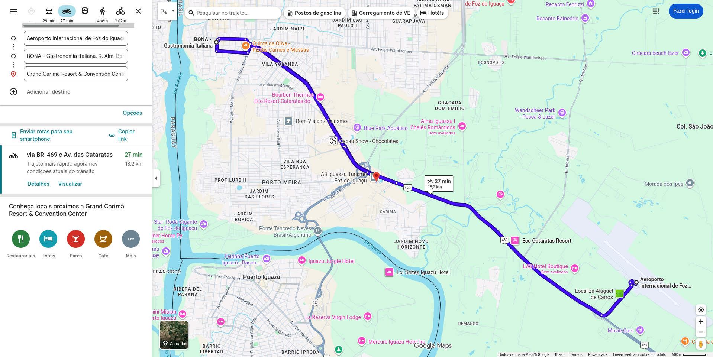
*Fonte: Adaptado de Google Maps pelos autores.*

---

## 12. Restaurante Tarobá (Bourbon Resort)
**Trilha:** Turismo | **Tipo:** Alimentação
**Fonte:** [Link Google Maps](https://maps.app.goo.gl/VKg19ARikhtX8uZk7)

> **Descrição Curada:** 
Restaurante de alta gastronomia situado no início da Avenida das Cataratas, ideal para um jantar requintado sem precisar fazer grandes desvios da rota.

**Relação Espacial:**
*(Abaixo, visualização do trajeto: Aeroporto → Restaurante Tarobá → Grand Carimã)*
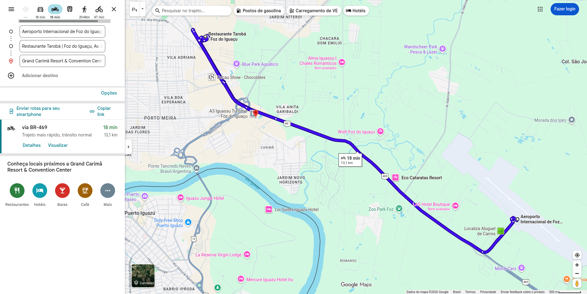
*Fonte: Adaptado de Google Maps pelos autores.*

---

## 13. Três Fronteiras Artesanato
**Trilha:** Compras | **Tipo:** Lazer
**Fonte:** [Link Google Maps](https://maps.app.goo.gl/2c6fh7sQyqyEv1Kw9)

> **Descrição Curada:** 
Loja de rua independente focada em artesanato local e souvenires, proporcionando uma experiência de compras cultural sem entrar em shoppings.

**Relação Espacial:**
*(Abaixo, visualização do trajeto: Aeroporto → Três Fronteiras Artesanato → Grand Carimã)*
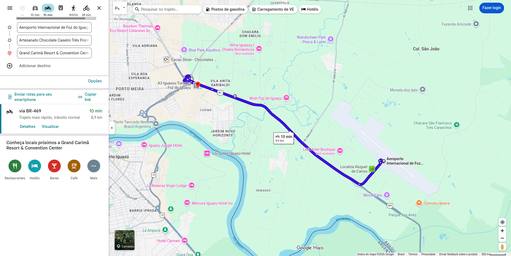
*Fonte: Adaptado de Google Maps pelos autores.*

---

## 14. Cataratas Souvenirs
Detalhe: O nome no maps é 'Pedacinho de Foz - Cataratas Park Hotel'

**Trilha:** Compras | **Tipo:** Lazer
**Fonte:** [Link Google Maps](https://maps.app.goo.gl/MnpPgBg5xjt78bjk8)

> **Descrição Curada:** 
Ampla loja de presentes e artigos regionais variados. Ponto estratégico para turistas garantirem lembranças de última hora na volta para o hotel.

**Relação Espacial:**
*(Abaixo, visualização do trajeto: Aeroporto → Cataratas Souvenirs → Grand Carimã)*
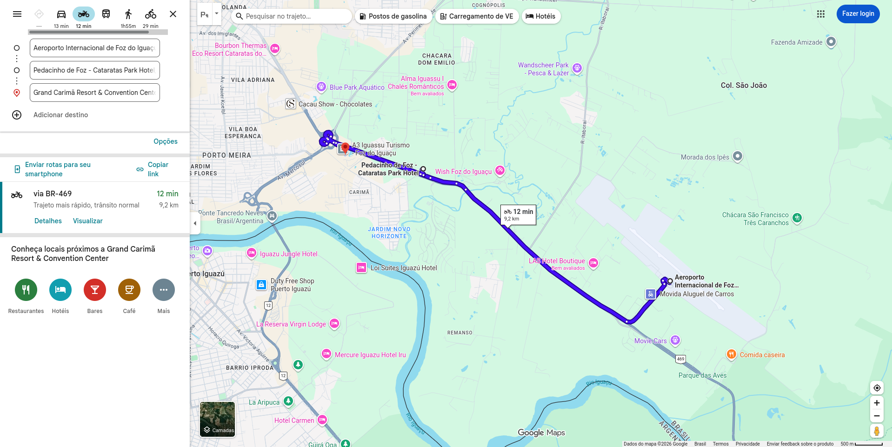
*Fonte: Adaptado de Google Maps pelos autores.*

---

## 15. Supermercado Ítalo - Vila Yolanda
**Trilha:** Compras | **Tipo:** Alimentação
**Fonte:** [Link Google Maps](https://maps.app.goo.gl/NaEV8yuxYr3Y8ffT8)

> **Descrição Curada:** 
Supermercado completo localizado estrategicamente na avenida principal. É a parada ideal para os turistas comprarem lanches, bebidas e conveniências antes de seguirem para o hotel.

**Relação Espacial:**
*(Abaixo, visualização do trajeto: Aeroporto → Supermercado Ítalo → Grand Carimã)*
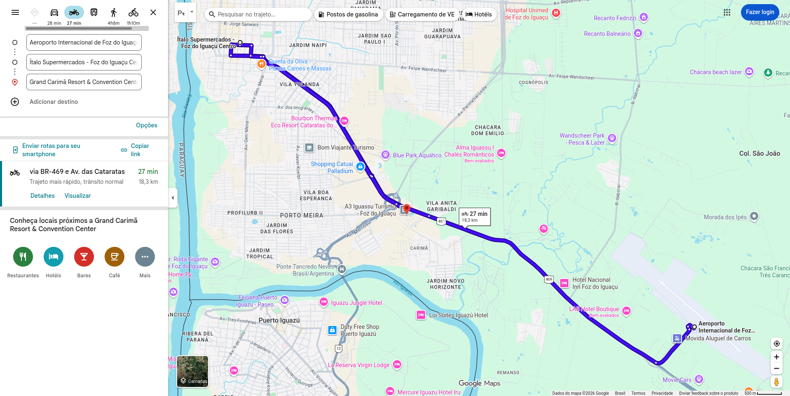
*Fonte: Adaptado de Google Maps pelos autores.*

---

## 16. ODA Vinhoteca Duty Free
**Trilha:** Compras | **Tipo:** Alimentação
**Fonte:** [Link Google Maps](https://maps.app.goo.gl/MjyP2GnYn3rJSS119)

> **Descrição Curada:** 
Loja franca (duty-free) especializada em vinhos argentinos, bebidas e empório gastronômico livre de impostos na rota turística principal.

**Relação Espacial:**
*(Abaixo, visualização do trajeto: Aeroporto → Oda Duty Free → Grand Carimã)*
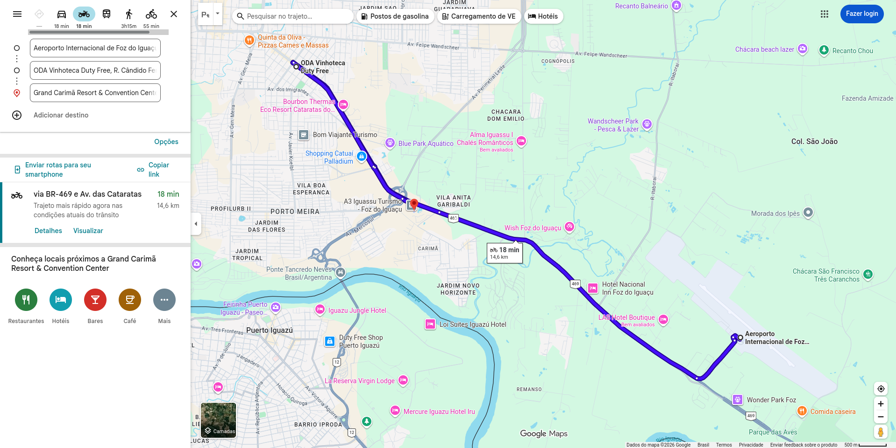
*Fonte: Adaptado de Google Maps pelos autores.*

---

## 17. Aquamania Foz
**Trilha:** Turismo | **Tipo:** Lazer
**Fonte:** [Link Google Maps](https://maps.app.goo.gl/JzqyHn3x4qegbDLa8)

> **Descrição Curada:** 
Parque aquático tradicional com toboáguas e piscinas recreativas. Fica estrategicamente posicionado na avenida principal, sendo uma opção de lazer sem grandes deslocamentos.

**Relação Espacial:**
*(Abaixo, visualização do trajeto: Aeroporto → Aquamania Foz → Grand Carimã)*
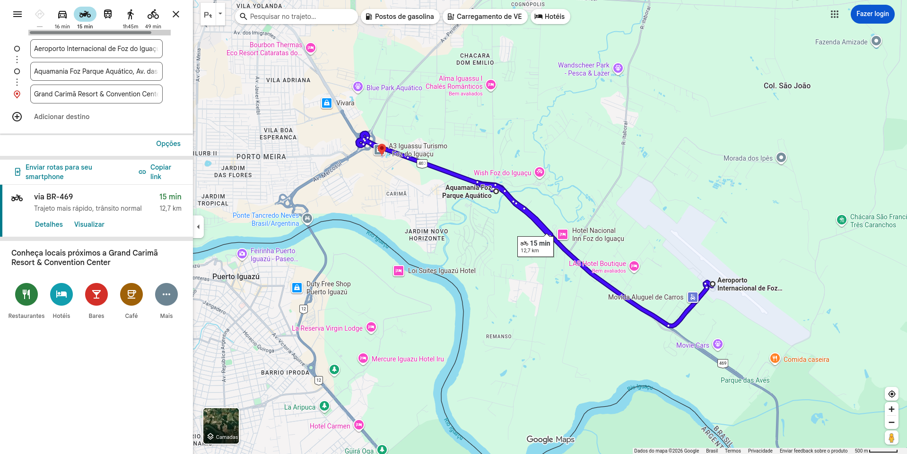
*Fonte: Adaptado de Google Maps pelos autores.*

---

## 18. Adrena Kart Foz
**Trilha:** Turismo | **Tipo:** Lazer
**Fonte:** [Link Google Maps](https://maps.app.goo.gl/K2q72bFA4NT3DL7b7)

> **Descrição Curada:** 
Pista de kart profissional localizada diretamente na rodovia principal, oferecendo uma opção de lazer focada em velocidade e adrenalina para grupos.

**Relação Espacial:**
*(Abaixo, visualização do trajeto: Aeroporto → Adrena Kart Foz → Grand Carimã)*
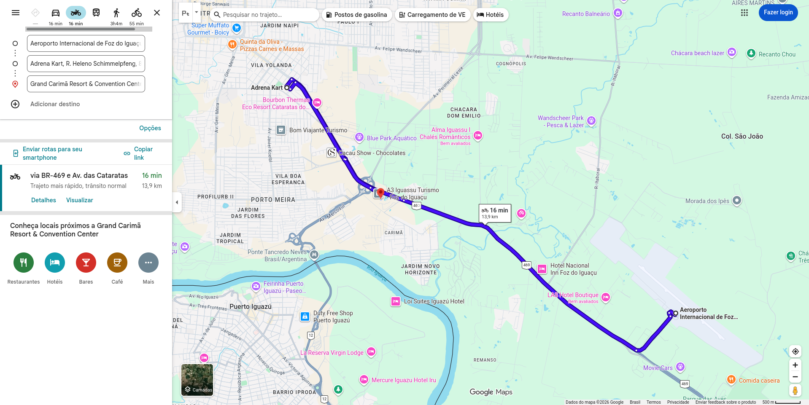
*Fonte: Adaptado de Google Maps pelos autores.*